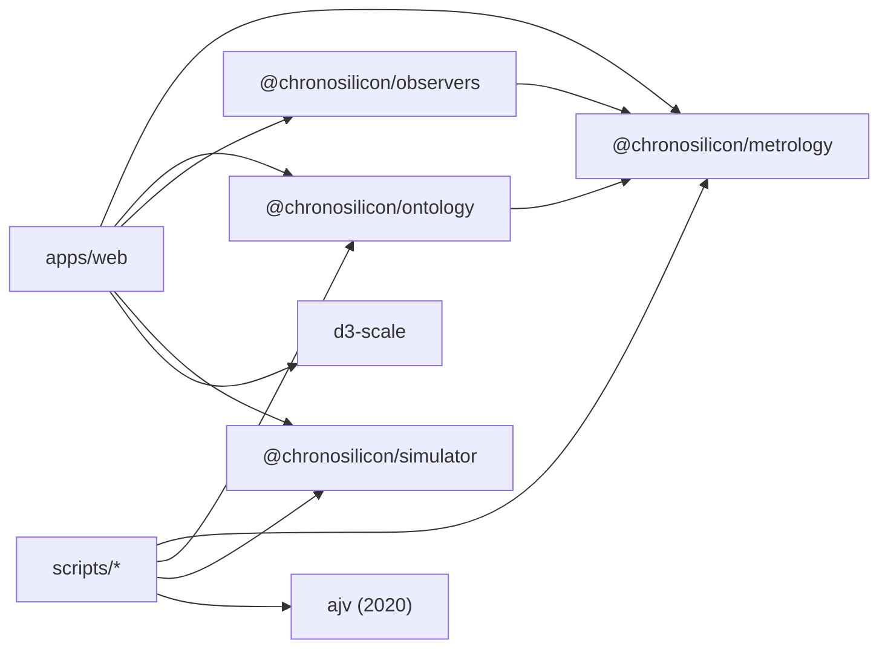
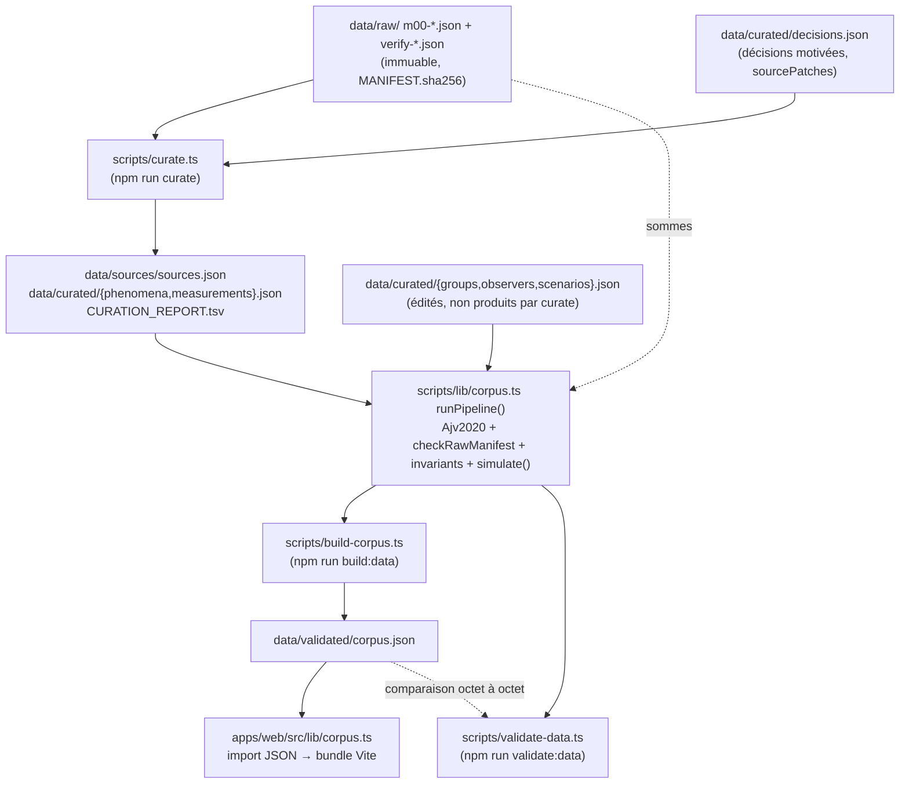

# AUDIT-01 — Pièce : architecture implémentée

- Révision décrite : `491c989d46d0d75ecedd9741ef4b6586892b80ae` (branche `develop`).
- Portée : uniquement ce qui existe dans le dépôt à cette révision. Constats tirés de
  la lecture des fichiers cités et de recherches `grep` ; aucun verdict d'audit,
  aucune validation externe revendiquée.

## 1. Monorepo (npm workspaces)

`package.json` (racine) déclare `"workspaces": ["packages/*", "apps/*"]`, `engines.node >=24`,
et les scripts `lint`, `typecheck`, `build:data`, `validate:data`, `test`, `build`,
`preview`, `test:e2e`, `check`, `curate`, `contribute:check`.

| Chemin | Rôle (en-tête du fichier source) |
|---|---|
| `packages/metrology/src/{index,stats}.ts` | Grandeurs SI, unités, contrôles dimensionnels ; quantiles Hyndman-Fan type 7 (ADR-0008) |
| `packages/ontology/src/index.ts` | Contrats typés reflétant `schemas/*.schema.json` ; `normalize`, `checkInvariants`, `checkV2Invariants`, `checkScenarios`, `resolveObservers` |
| `packages/observers/src/{index,format}.ts` | Conversion durée physique → temps subjectif d'un observateur (CS-03, CS-07) |
| `packages/simulator/src/index.ts` | Moteur abstrait à événements discrets, temps entier en femtosecondes (BigInt) (ADR-0007) |
| `apps/web/` | Application Svelte 5 + Vite (`@chronosilicon/web`) |
| `scripts/` | `curate.ts`, `build-corpus.ts`, `validate-data.ts`, `contribute-check.ts`, `lib/corpus.ts`, `run-gate.sh` |
| `schemas/` | 8 schémas JSON : `common`, `sources`, `phenomena`, `measurements`, `groups`, `observers`, `scenarios`, `raw-extraction` |
| `data/raw/` | 6 extractions `m00-*.json`, 6 verdicts `verify-*.json`, `MANIFEST.sha256` |
| `data/curated/` | `phenomena`, `measurements`, `groups`, `observers`, `scenarios`, `decisions.json`, `CURATION_REPORT.tsv` |
| `data/sources/sources.json` | Registre des sources (écrit par `scripts/curate.ts`, cf. §2) |
| `data/validated/corpus.json` | Corpus dérivé, versionné dans Git |
| `tests/` | Tests Vitest (`*.test.ts`), `tests/e2e/site.spec.ts` (Playwright, 24 `test(`), `tests/fixtures/minimal.json` |
| `docs/` | CS-00 à CS-14, `adr/` (ADR-0001 à 0009), `reports/` (G0 à G5, revues, `logs/`), `audits/`, `archives/`, `kit/` |

Chaque `packages/*/package.json` expose `".": "./src/index.ts"` (source TypeScript, pas
de build intermédiaire) et **ne déclare aucune dépendance** : la résolution
`@chronosilicon/*` repose sur les liens symboliques de workspace
(`node_modules/@chronosilicon/* -> ../../packages/*`). `apps/web/package.json` ne
déclare que `svelte`, `d3-array`, `d3-scale` (dépendances) et l'outillage Vite/Svelte.

Graphe des dépendances, d'après les `import` effectifs :

- `simulator` n'importe aucun autre paquet ; aucun cycle.
- `d3-scale` est importé une seule fois (`scaleLog`, `apps/web/src/components/Timeline.svelte`).
  `d3-array` est déclaré dans `apps/web/package.json` mais aucun import n'a été trouvé
  dans `apps/`, `packages/`, `scripts/`, `tests/`.

## 2. Chaîne de données

- **Curation** (`scripts/curate.ts`) : lit `data/raw/m00-*.json` et `verify-*.json`, refuse tout
  autre `.json` de `data/raw/`. Correspondance verdict → statut (l. 61) : `confirmed` et
  `confirmed_with_fix` → `qualified`, `unreachable` → `pending`, `inadequate` → `contested`,
  `mismatch` → `rejected`. Précédence des champs (l. 124-126) : **décision manuelle >
  correctif du vérificateur > extraction brute**, un `null` explicite l'emportant ; une
  décision peut aussi forcer le statut (l. 142). Une valeur calculée n'est qualifiée que si
  toutes ses entrées le sont (point fixe, l. 183). Sorties (l. 202-206) :
  `data/sources/sources.json`, `data/curated/phenomena.json`, `data/curated/measurements.json`,
  `data/curated/CURATION_REPORT.tsv`. Le registre des sources n'est donc **pas** dans
  `data/curated/` mais dans `data/sources/`.
- **Pipeline** (`scripts/lib/corpus.ts`, `runPipeline`) :
  1. validation des six fichiers d'entrée par Ajv 2020 (`new Ajv2020({ allErrors: true, strict: true })`,
     schémas de `schemas/`, identifiants `https://chronosilicon.local/schemas/...`) ;
  2. `checkRawManifest()` : chaque `data/raw/*.json` doit figurer dans `MANIFEST.sha256` avec la
     bonne somme SHA-256, et inversement ;
  3. `checkInvariants` (sources, phénomènes, mesures), puis `normalize` des seules mesures
     `qualified`, puis `checkV2Invariants` (groupes, observateurs) et `checkScenarios` ;
  4. exécution réelle de chaque scénario par `simulate()` ; une erreur fait échouer ;
  5. assemblage du `Corpus` : `corpusVersion = 0.3.0+<12 hex>` dérivé des SHA-256 des entrées
     (`inputs`), phénomènes et sources restreints à ceux utilisés par des mesures qualifiées,
     mesures non qualifiées publiées dans `withheld` avec statut et motif (ADR-0008).
- **`build:data`** (`scripts/build-corpus.ts`) écrit `data/validated/corpus.json`
  (`JSON.stringify(..., 2)` + saut de ligne) ou sort en code 1.
- **`validate:data`** (`scripts/validate-data.ts`) rejoue le pipeline, échoue si
  `corpus.json` est absent ou diffère du résultat recalculé (« stale »), et applique
  `checkExtraction` de `scripts/contribute-check.ts` à chaque `m00-*.json` (non strict pour
  les fichiers `m00-2026-11-26-*`, strict pour les autres).
- **`contribute:check`** (`scripts/contribute-check.ts`) : schéma `raw-extraction`, sources
  résolubles, unités connues ; en mode strict, citation non vide, localisateur, protocole
  pour les valeurs mesurées, compatibilité unité/grandeur. Modèle d'issue associé :
  `.github/ISSUE_TEMPLATE/data-contribution.md`.
- **Intégration web** : `apps/web/src/lib/corpus.ts` importe
  `../../../../data/validated/corpus.json` ; le corpus est inclus dans le bundle à la
  compilation (`server.fs.allow: ['../..']` dans `apps/web/vite.config.ts`).

## 3. Application web (`apps/web`)

- **Pile** : Svelte 5.57.3 (runes `$state`, `$derived`, `$effect`), Vite 8.3.8,
  `@sveltejs/vite-plugin-svelte`, `svelte-check --fail-on-warnings`. Montage dans
  `src/main.ts` (`mount(App, { target: #app })`).
- **Routage par hash** : `src/lib/url-state.ts` définit `ROUTES` (`timeline`, `converter`,
  `architecture`, `observers`, `simulation`, `immersion`, `comparison`, `laboratory`, `about`)
  et sérialise l'état dans `#/route?k=v`. `src/lib/app.svelte.ts` lit le hash au démarrage,
  écoute `hashchange`, et écrit par `history.replaceState` (ou `pushState` si demandé).
- **État d'URL** (`UrlState`) : `route`, `lang`, `level`, `frequencyHz`, `axis`, `view`,
  `domains`, `provenance`, `selected`, `group`, `observed`, `scenario`, `capacity`. Seuls
  les paramètres validés sont relus (listes autorisées, motif d'identifiant
  `^[a-z0-9][a-z0-9-]{1,95}$`, fréquence bornée à 1e15) ; sinon valeur par défaut.
- **i18n** (`src/lib/i18n.ts`) : `MessageKey = keyof typeof fr` ; la table `en` est typée
  `Record<MessageKey, string>`, donc une clé absente de `en` est une erreur de typage.
  `app.t` n'accepte qu'une `MessageKey`. À l'exécution, `translate()` lève
  `MissingMessageError` pour une clé ou un paramètre `{x}` manquant. Un transtypage
  `as MessageKey` subsiste dans `App.svelte` (titre de document). Langue initiale :
  hash, sinon `navigator.language`.
- **Composants** (`src/components/`) :
  - `Timeline.svelte` — frise logarithmique (`scaleLog` de d3-scale), axe physique ou subjectif, vue graphique ou tableau, filtres domaine/provenance.
  - `Sheet.svelte` — fiche d'une mesure sélectionnée (montée globalement dans `App.svelte`).
  - `Converter.svelte` — conversion d'une durée vers le temps subjectif (metrology + observers).
  - `Architecture.svelte` — hiérarchies (groupes `hierarchy`) en cycles (ADR-0006).
  - `Comparison.svelte` — groupes `comparison`, membres rangés par année, avertissement de comparabilité.
  - `Observers.svelte` — une durée observée selon les observateurs du corpus.
  - `Simulation.svelte` — exécution d'un scénario par `@chronosilicon/simulator`, réglage `cap=`, journal d'événements, export JSON.
  - `Immersion.svelte` — journal à la première personne dérivé de la simulation (`lib/narrative.ts`).
  - `Laboratory.svelte` — mesures navigateur (`lib/browser-measure.ts`), valeurs `withheld`, export des échantillons.
  - `ExportPanel.svelte` — export JSON/CSV des mesures affichées (utilisé par `Timeline`).
  - `ObserverControl.svelte` — saisie de la fréquence de l'observateur (utilisé par `Timeline`, `Converter`).
  - `About.svelte` — présentation, lien vers le dépôt GitHub.
  - `Unavailable.svelte` — espace non encore livré ; `PLANNED` est vide dans `App.svelte` et toutes les routes ont un composant, la branche `{:else}` n'est donc pas atteinte à cette révision.
- **Exports** (`src/lib/export.ts`) : `buildJsonExport`, `buildCsvExport` (avec
  `csvEscape`), `download()` via `Blob` + `URL.createObjectURL` + `<a download>` ; aucun envoi.
- **version.json et 404** : le plugin `chronosilicon-static-extras` de
  `apps/web/vite.config.ts` émet `version.json` (`{ app, commit }`, commit = `GITHUB_SHA`
  ou `git rev-parse HEAD`) et `404.html` ; `__APP_VERSION__` et `__COMMIT__` sont injectés par `define`.
- **Chemin de base** : `base` = `BASE_PATH` (défaut `/chronosilicon/`, `/` final forcé).
  `pages.yml` le fournit depuis `actions/configure-pages` ; `ci.yml` fixe `/chronosilicon/`.
  Build : `outDir: dist`, `sourcemap: true`, `target: es2022`.

## 4. Chaîne d'outils

- **`compose.yaml`** : un seul service `node`, profil `cli` (non permanent), image
  `mcr.microsoft.com/playwright:v1.65.0-noble@sha256:9beb5460…3dbe`, `user: "1032:1033"`,
  réseau externe `chronosilicon-internal`, limites 2 CPU / 3 Go / 1024 pids, `HOME` et
  cache npm sous `/work/.cache`. La même référence d'image (tag + digest) figure dans
  `ci.yml`, `pages.yml` et `scripts/run-gate.sh` ; `@playwright/test` = 1.65.0, avec
  `overrides` `playwright`/`playwright-core` 1.65.0 (ADR-0002).
- **CI** (`.github/workflows/ci.yml`) : `push` sur toutes les branches, `pull_request`,
  `workflow_dispatch` ; `permissions: contents: read` ; conteneur Playwright épinglé ;
  étapes `npm ci`, `lint`, `typecheck`, `validate:data`, `test`, `build`, `test:e2e`
  (`BASE_PATH=/chronosilicon/`) ; rapport Playwright téléversé en cas d'échec. Aucun déploiement.
- **Déploiement** (`.github/workflows/pages.yml`) : déclenché par `push` sur `main` et
  `workflow_dispatch`, mais les deux jobs portent `if: github.ref == 'refs/heads/main'`.
  Permissions globales `contents: read` ; seul le job `deploy` reçoit `pages: write` et
  `id-token: write`. Le job `build` rejoue lint, typecheck, validate:data, test, test:e2e
  puis build sous le chemin de base réel, et téléverse `apps/web/dist`. Actions épinglées
  par SHA complet : `actions/checkout@3d3c42e…` (v7.0.1), `actions/configure-pages@45bfe01…`
  (v6.0.0), `actions/upload-pages-artifact@fc324d3…` (v5.0.0), `actions/deploy-pages@368f825…`
  (v5.0.1), et dans `ci.yml` `actions/upload-artifact@cf430e0…` (v7.0.2). Aucun secret
  autre que le jeton implicite et OIDC.
- **Portes** (`scripts/run-gate.sh G0|G1|…`) : enchaîne `npm ci`, `lint`, `typecheck`,
  `validate:data`, `test`, `build` (+ `test:e2e` hors G0), écrit un journal par étape et
  `summary.txt` (date UTC, commit, nombre de fichiers modifiés hors `docs/reports/`,
  versions Node/npm, image, `uname`) dans `docs/reports/logs/<porte>/` ; code de sortie 1 si une étape échoue.
- **Tests** : `vitest.config.ts` inclut `tests/**/*.test.ts`, `packages/*/src/**/*.test.ts`,
  `apps/web/src/**/*.test.ts` (environnement `node`). `playwright.config.ts` : quatre projets
  (desktop Chromium, desktop Firefox, mobile WebKit iPhone 13, mobile Chromium Pixel 7),
  serveur `vite preview` sur le build de production, `retries: 0`, `forbidOnly`. Contrôle
  d'accessibilité par `@axe-core/playwright` dans `tests/e2e/site.spec.ts`.

## 5. Exécution statique

- Aucun backend : le livrable est `apps/web/dist` (HTML, JS, CSS, `version.json`, `404.html`) servi par GitHub Pages.
- `grep -rnE "fetch\(|XMLHttpRequest|WebSocket|sendBeacon|EventSource|import\("` sur
  `apps/web/src` : **aucune occurrence**.
- `grep -rniE "document\.cookie|localStorage|sessionStorage|indexedDB|analytics|gtag|plausible|matomo"`
  sur `apps/web/src` : **aucune occurrence**. `apps/web/index.html` ne charge aucune
  ressource externe (favicon en `data:`) ; `app.css` ne contient ni `@import` ni `url(`.
- URL absolues présentes dans le code source : liens `<a>` vers le dépôt GitHub
  (`About.svelte`, `Laboratory.svelte`) ; dans le bundle, les URL des sources citées du
  corpus et des chaînes de Svelte. Ce sont des liens ou du texte, pas des requêtes.
- Test e2e « loads under the Pages base path… » (`tests/e2e/site.spec.ts`, l. 18-30) : il
  enregistre toute requête d'une autre origine que le serveur local et exige une liste vide.
- Seule lecture de l'environnement : `navigator.language`, et dans le Laboratoire
  `userAgent`, `crossOriginIsolated`, `hardwareConcurrency`, conservés en mémoire et exportables par l'utilisateur.

## 6. Écarts avec `docs/CS-09_Architecture.md`

CS-09 est un paragraphe unique de propositions (« Monorepo proposé », « Scripts proposés »).

| Exigence CS-09 | État à HEAD | Motif / ADR |
|---|---|---|
| `apps/web` Svelte/Vite | Implémenté | D11 (`docs/CS-01_Decisions.md`), ADR-0001 |
| `packages/{ontology,metrology,observers,simulator}` | Implémenté | — |
| `packages/visualization` | **Absent** ; la visualisation est dans les composants de `apps/web` | Aucune ADR trouvée |
| `data/{raw,validated,sources}` | Implémenté, avec en plus `data/curated/` | ADR-0005 |
| `schemas/`, `tests/`, `docs/`, `.github/workflows/` | Implémenté | — |
| `benchmarks/` | **Absent** | Aucune ADR trouvée |
| `scenarios/` (racine) | **Déplacé** : `data/curated/scenarios.json` + `schemas/scenarios.schema.json` | ADR-0007 |
| README, LICENSE, CITATION.cff, CONTRIBUTING, CHANGELOG, CLAUDE, PROJECT_STATUS, NEXT_ACTIONS | Présents à la racine | — |
| TypeScript strict, fonctions pures, modèles séparés de l'UI | `"strict": true` dans `tsconfig.base.json` ; paquets sans dépendance UI | — |
| D3 pour échelles et graphiques | **Partiel** : seul `d3-scale` (`scaleLog`) est utilisé ; graphiques en SVG Svelte ; `d3-array` déclaré, non importé | Aucune ADR trouvée |
| Worker pour simulations bloquantes mesurées | **Absent** (aucun `Worker` dans `apps/web/src` ni `packages/`) ; les mesures du Laboratoire tournent aussi sur le fil principal | ADR-0007 §5 (simulation < 1 ms, Worker seulement sur mesure) ; aucune ADR pour le Laboratoire |
| WASM Rust uniquement sur preuve de goulot | Absent, conforme à la condition | D11 (« WASM si justifié ») |
| Données statiques JSON/CSV, validation à la compilation | JSON validé à la construction (`build:data`, `validate:data`) ; CSV seulement en export | ADR-0005 |
| Pages, pas de secrets ni d'API runtime | Implémenté (§4, §5) | ADR-0003 |
| Base Vite selon l'URL réelle ; hash routing | Implémenté (`BASE_PATH` depuis `configure-pages`, `#/route`) | — |
| npm workspaces, lockfile, Node LTS vérifiée, build reproductible | Workspaces, `package-lock.json`, versions exactes, image épinglée par digest | ADR-0002 |
| Scripts `npm ci`, `lint`, `typecheck`, `validate:data`, `test`, `test:e2e`, `build`, `preview` | Tous présents, plus `build:data`, `check`, `curate`, `contribute:check` | ADR-0005, ADR-0008 |
| CI distincte validation / déploiement, permissions minimales, actions épinglées, déploiement sur branche autorisée après succès | Implémenté (`ci.yml` / `pages.yml`, `needs: build`, `main` seulement) | ADR-0003 |
| IndexedDB facultatif ; export lisible | IndexedDB non utilisé (facultatif) ; exports JSON/CSV | — |
| Éviter les services tiers | Aucun appel tiers à l'exécution (§5) | — |
| Budgets de performance documentés, mesurer avant d'optimiser | **Absent** : aucun budget chiffré trouvé dans `docs/adr/`, `tests/` ni `apps/web/src` | Aucune ADR trouvée |
| GitHub canonique, copies Drive sans écrasement | Règle documentée | ADR-0004 |

Écarts de structure supplémentaires, non demandés par CS-09 : les paquets n'ont pas de
dépendances déclarées dans leur `package.json` et sont consommés sous forme de source `.ts`
(pas d'étape de build par paquet) ; `data/sources/sources.json` est un fichier dérivé, écrit par `scripts/curate.ts`.
